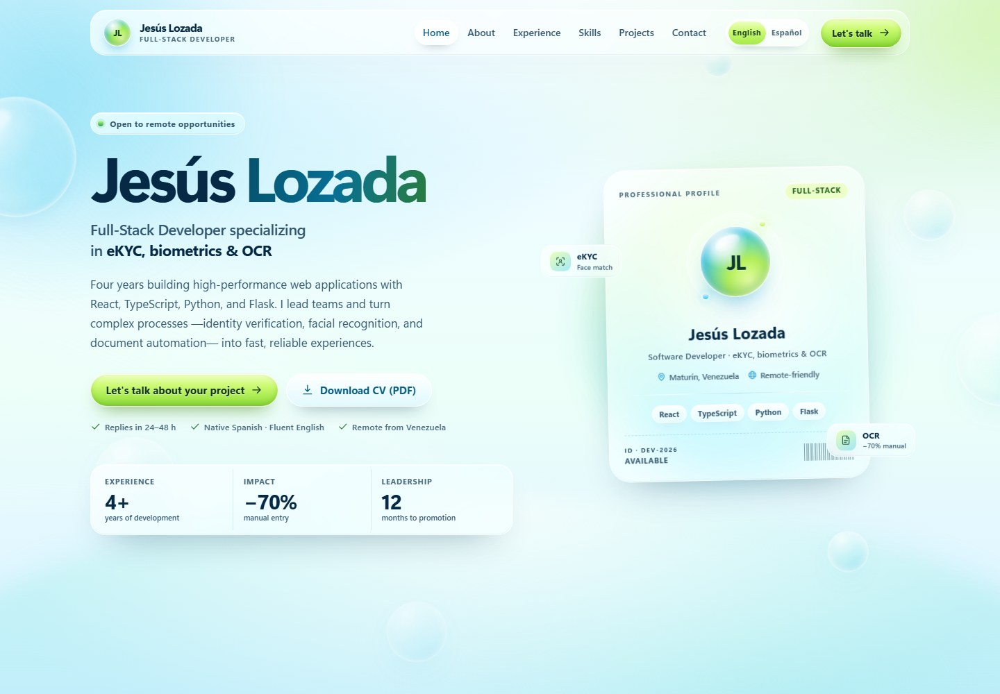

# Portafolio de Jesús Lozada

Portafolio profesional estático con estética **Frutiger Aero**, construido con **Vite 8**, **Tailwind CSS 4** y **JavaScript vanilla**. El sitio es bilingüe: **inglés como idioma principal** en la raíz y **español como versión secundaria** en `/es/`.



Vista previa en español: [`docs/preview-desktop-es.jpg`](docs/preview-desktop-es.jpg). Vista móvil: [`docs/preview-mobile.jpg`](docs/preview-mobile.jpg).

## Vista general

- Inglés primario: `/` y `/cv.html`.
- Español secundario: `/es/` y `/es/cv.html`, con selector de idioma accesible y conservación de la sección actual.
- Cinco proyectos: plataforma eKYC, automatización con OCR, modernización Angular → React, un CRM en desarrollo y un web scraper de empleo en desarrollo.
- Diseño glassmorphism, degradados cielo/agua, brillos, burbujas y botones glossy.
- Mobile-first de 320 px a 1440 px, sin scroll horizontal.
- Accesibilidad WCAG 2.2 AA: navegación por teclado, foco visible, formulario con errores accesibles, `prefers-reduced-motion` y fallback sin JavaScript.
- SEO bilingüe: HTML semántico, canonical, hreflang, Open Graph, Twitter Cards, JSON-LD (`Person`, `WebSite`, `ProfilePage`), `robots.txt` y `sitemap.xml`.
- Sin peticiones a terceros: sin CDNs, fuentes externas, analítica ni cookies.
- Dos CV web (`noindex`) y dos PDF A4 de una página:
  - `assets/Jesus-Lozada-CV-EN.pdf`
  - `assets/Jesus-Lozada-CV-ES.pdf`
- Formulario de contacto sin backend: valida y abre el cliente de correo con el mensaje preparado, en el idioma de la página.

## Requisitos

- Node.js 20.19+ o 22.12+ (probado con 22.20) y npm.
- Microsoft Edge o Chrome instalado solo para regenerar los PDFs del CV.
- Python 3 con Pillow solo para regenerar las imágenes Open Graph y el Apple Touch Icon.

## Comandos

```bash
npm install
npm run dev        # servidor de desarrollo
npm run build      # genera dist/
npm run preview    # sirve dist/ en http://127.0.0.1:4173
npm run cv:pdf     # regenera ambos PDFs (requiere build previo)
npm run assets:og  # regenera las dos imágenes OG y el Apple Touch Icon (requiere Pillow)
```

Secuencia al cambiar los CV:

```bash
npm run build
npm run cv:pdf
```

El script genera `Jesus-Lozada-CV-EN.pdf` y `Jesus-Lozada-CV-ES.pdf` en `public/assets/` y en `dist/assets/`.

## Estructura

```text
index.html                    Portafolio en inglés (primario)
es/index.html                 Portafolio en español
cv.html                       CV web en inglés
es/cv.html                    CV web en español
vite.config.js                Build multi-página, base relativa
public/
  robots.txt
  sitemap.xml
  assets/
    favicon.svg
    apple-touch-icon.png
    og-cover.jpg              Open Graph en inglés
    og-cover-es.jpg           Open Graph en español
    Jesus-Lozada-CV-EN.pdf
    Jesus-Lozada-CV-ES.pdf
src/
  css/                        Tokens, base, aero, componentes, secciones, motion y CV
  js/
    i18n.js                   Cadenas dinámicas EN/ES
    main.js
    modules/                  Navegación, reveals, spotlight, contacto, UI e idioma
scripts/
  generate-og.py              OG bilingüe + Apple Touch Icon
  generate-cv-pdf.mjs         PDFs EN/ES con Edge headless
docs/                         Capturas de vista previa
```

## Idiomas y SEO

- `/` es la versión inglesa y `x-default`.
- `/es/` es la versión española.
- Ambas páginas declaran:

```html
<link rel="alternate" hreflang="en" href="https://jesuslozada.dev/" />
<link rel="alternate" hreflang="es" href="https://jesuslozada.dev/es/" />
<link rel="alternate" hreflang="x-default" href="https://jesuslozada.dev/" />
```

- `canonical`, `og:url`, `og:image`, `og:locale` y JSON-LD están localizados.
- El selector de idioma conserva el hash de la sección actual (`#projects`, etc.) y actualiza el enlace en tiempo real.
- Los CV también tienen enlaces alternos EN/ES, pero siguen siendo `noindex, follow`.
- No hay redirección automática por `Accept-Language`; el usuario elige idioma y Google usa `hreflang`.

## Antes de publicar: personalización obligatoria

El sitio funciona tal cual, pero incluye placeholders deliberados que debes reemplazar **en las dos versiones**:

1. **Dominio canónico.** Cambia `https://jesuslozada.dev/` en:
   - `index.html` y `es/index.html`: canonical, `hreflang`, `og:url`, `og:image`, Twitter y `@id`/`url` del JSON-LD.
   - `public/robots.txt` y `public/sitemap.xml`.
   - `cv.html` y `es/cv.html`: enlaces de portafolio y metadatos alternos.
   - Si cambia el dominio, vuelve a generar las imágenes OG con `npm run assets:og`.
2. **GitHub y LinkedIn.** Reemplaza `https://github.com/tu-usuario` y `https://www.linkedin.com/in/tu-usuario` en:
   - El bloque `sameAs` del JSON-LD de ambos idiomas.
   - Los enlaces del bloque de contacto.
   - Los enlaces del pie de página.
3. **Fechas de Noa Export.** Se muestran literalmente como `sep 2024 — oct 2026` / `Sep 2024 — Oct 2026`. Si sigues en el puesto, cámbialo a `Actualidad` / `Present` en los portafolios, los CV y los PDFs.
4. **WhatsApp.** El enlace asume que `+58 412 701 1657` tiene WhatsApp. Si no aplica, elimina ese enlace en ambas versiones.
5. **PDFs del CV.** Regenera ambos PDFs después de cualquier cambio de contenido.
6. **Email.** Si cambias de correo, actualízalo en `index.html`, `es/index.html` (contacto, formulario, JSON-LD y pie), en `src/js/modules/contact.js` y en ambos CV.
7. **Títulos SEO.** El título inglés se mantuvo exactamente como fue solicitado; supera los 70 caracteres y Google podría truncarlo. El título español está localizado.
8. **Disponibilidad y respuesta.** El sitio afirma disponibilidad para oportunidades remotas y respuesta en 24–48 h. Ajusta esos textos si no aplican.
9. **Nuevos proyectos.** Las tarjetas del CRM y del scraper usan URLs placeholder:
   - `https://example.com/crm` y `https://github.com/tu-usuario/crm`.
   - `https://example.com/job-scraper` y `https://github.com/tu-usuario/job-scraper`.
   Reemplázalas por las reales o elimina los bloques `.project__links` que no apliquen, en ambos idiomas.

## Despliegue

El resultado es 100 % estático. Publica la carpeta `dist/`.

- **Netlify / Vercel:** build `npm run build`, directorio de publicación `dist`.
- **GitHub Pages:** publica `dist/` con una GitHub Action. `base: "./"` genera rutas relativas también para `dist/es/`; el dominio canónico y el sitemap deben apuntar a la URL final.
- El servidor debe servir `/es/` como directorio con `index.html` (comportamiento estándar de Netlify, Vercel, GitHub Pages y Vite Preview).
- Configura HTTPS y el dominio definitivo. Después, envía `sitemap.xml` en Google Search Console.

## Formulario de contacto

No hay backend ni servicios de terceros. Al enviar un formulario válido se abre el cliente de correo con asunto, saludo y cuerpo preparados en el idioma de la página. Los usuarios también pueden copiar el email o el teléfono. Los datos no salen del navegador.

## Regenerar imágenes

`scripts/generate-og.py` genera `og-cover.jpg` y `og-cover-es.jpg` y usa Segoe UI si está disponible en Windows, con DejaVu Sans como respaldo.

```bash
python -m pip install pillow
python scripts/generate-og.py
```

## Rendimiento y accesibilidad verificados

Lighthouse móvil local (Edge headless, 390×844), en inglés y español:

| Categoría | EN | ES |
| --- | --- | --- |
| Performance | 100 | 100 |
| Accessibility | 100 | 100 |
| Best Practices | 100 | 100 |
| SEO | 100 | 100 |

También se verificó: axe sin violaciones en ambos idiomas, un solo `<h1>` por página, jerarquía de encabezados, anclas válidas, cambio de idioma con hash preservado, formularios localizados, menú móvil con Escape y retorno de foco, fallback sin JS, `prefers-reduced-motion`, PDFs de una página y ausencia de desbordamiento entre 320 y 1440 px.

Las puntuaciones pueden variar según red, dispositivo y hosting.

## Notas de diseño

- La tipografía es la del sistema (`Segoe UI` en Windows, `system-ui` en otros), lo que evita fuentes externas y protege el LCP.
- No hay foto de perfil: el hero usa un orbe con iniciales. Para añadir una foto, sustituye el contenido de `.id-card__avatar` por una imagen optimizada en WebP, con `alt` descriptivo y dimensiones explícitas.
- Las animaciones se desactivan con `prefers-reduced-motion`; el contenido es visible sin JavaScript.
- Los iconos son un sprite SVG inline, sin dependencias.
- Las capturas de `docs/` se regeneran con el sitio servido en local; la versión inglesa es la vista previa principal.
